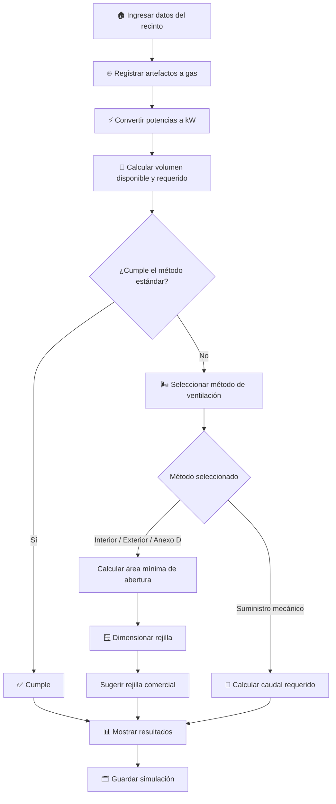
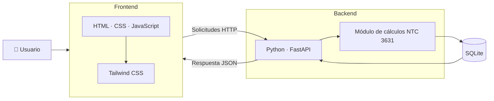

# 🌬️ VentiGas NTC

### Calcula la ventilación. Cuida el aire.

  
  
  

  <strong>Una herramienta web educativa para simular, verificar y calcular los requerimientos de ventilación de recintos interiores con artefactos a gas.</strong>

---

## 📌 Sobre el proyecto

**VentiGas NTC** es una aplicación web educativa que busca simplificar los cálculos de ventilación de recintos interiores donde se encuentran instalados artefactos a gas, tomando como referencia los métodos contemplados en la **NTC 3631**.

El proyecto transforma un modelo de cálculo originalmente trabajado en Excel en una herramienta digital donde el usuario puede ingresar las características del recinto y sus artefactos, verificar las condiciones del método estándar y obtener los requerimientos de ventilación correspondientes.

Cuando el recinto no cumple con las condiciones establecidas para el método estándar, la aplicación permite evaluar diferentes métodos de ventilación, calcular las áreas mínimas requeridas y sugerir dimensiones de rejillas comerciales.

> 🚧 **Estado actual:** proyecto en desarrollo. El repositorio reúne la documentación, la base de datos de referencia y el modelo de cálculo. La implementación completa de la aplicación web se encuentra pendiente.

> ⚠️ **Aviso:** esta herramienta tiene fines educativos y de apoyo. Los resultados no reemplazan la revisión de un profesional competente ni la consulta de la normativa vigente.

---

## 🎯 Objetivo

Desarrollar una herramienta web educativa que facilite la comprensión y aplicación de los cálculos de ventilación para recintos con artefactos a gas, permitiendo realizar simulaciones de manera organizada, reducir errores de cálculo manual y consultar resultados de forma clara.

---

## 🧩 Problemática

Actualmente, los cálculos de ventilación utilizados como referencia en este proyecto se encuentran organizados en un libro de Excel con múltiples hojas, casos y fórmulas.

Este método puede dificultar la consulta de resultados, la interpretación de los procedimientos y el manejo de la información cuando se realizan diferentes simulaciones.

VentiGas NTC propone llevar este proceso a una aplicación web que permita centralizar los datos, automatizar los cálculos y ofrecer una experiencia más sencilla, organizada e intuitiva.

---

## ✨ Funcionalidades proyectadas

- 🏠 Registro de las características del recinto: ancho, largo, altura y tipo.
- 🔥 Registro de los artefactos a gas instalados.
- ⚡ Conversión automática de potencia desde BTU/h y MJ/h a kW.
- 📐 Cálculo del volumen disponible y volumen requerido.
- ✅ Verificación del cumplimiento del método estándar.
- 🌬️ Cálculo del área mínima de abertura según el método de ventilación seleccionado.
- 🪟 Sugerencia de dimensiones para rejillas comerciales.
- 💨 Cálculo del caudal de aire requerido para suministro mecánico.
- 📚 Consulta de casos de referencia provenientes del Excel original.
- 🗂️ Guardado y consulta del historial de simulaciones.

---

## 🌬️ Métodos de ventilación contemplados

| Método | Referencia NTC 3631 |
|---|---|
| Aire del interior, mismo piso | 4.1.2 a |
| Aire del interior, diferentes pisos | 4.1.2 b |
| Aire del exterior — dos aberturas | 4.2.1 |
| Aire del exterior — una abertura | 4.2.2 |
| Combinación de aire interior y exterior | 4.3 |
| Suministro mecánico | 4.4 |
| Recintos a menos de 260 msnm | Anexo D |

---

## ⚙️ Modelo de cálculo

La aplicación contempla diferentes cálculos para determinar las condiciones de ventilación de un recinto.

### 1. Potencia total instalada

Se suman las potencias de todos los artefactos registrados, expresadas en kilovatios.

\[
P_{total}=\sum P_i
\]

### 2. Volumen del recinto

\[
V_{disp}=Ancho \times Largo \times Altura
\]

### 3. Volumen requerido

\[
V_{req}=3.4\ \frac{m^3}{kW}\times P_{total}
\]

### 4. Verificación del método estándar

Se verifica la relación entre el volumen disponible y la potencia total instalada.

\[
\frac{V_{disp}}{P_{total}}\geq3.4\ \frac{m^3}{kW}
\]

Si se cumple la condición, el recinto cumple el criterio del método estándar contemplado en el modelo.

Si no se cumple, se requiere evaluar el método de ventilación correspondiente.

### 5. Cálculo de aberturas

| Método | Criterio de cálculo |
|---|---|
| Interior — mismo piso | Mayor entre 645 cm² y 22 cm²/kW |
| Interior — diferentes pisos | 44 cm²/kW |
| Exterior — método 1 | 6 cm²/kW para flujo directo o vertical; 11 cm²/kW para horizontal |
| Exterior — método 2 | 11 cm²/kW |
| Combinación interior y exterior | Área exterior según método 4.2 × (1 − V disponible / V requerido) |
| Suministro mecánico | 0,034 m³/min por kW + extracción de la cocina |

### 6. Dimensionamiento de rejillas

El área total de la rejilla se calcula a partir del área libre requerida, considerando el factor utilizado en el modelo.

\[
A_{total}=\frac{A_{libre}}{0.6}
\]

Para una rejilla cuadrada:

\[
Lado=\sqrt{A_{total}}
\]

Posteriormente, se sugiere una dimensión comercial inmediatamente superior al tamaño calculado.

---

## 🔄 Flujo de una simulación

---

## 🏗️ Arquitectura propuesta

El proyecto contempla una arquitectura dividida en tres componentes principales: frontend, backend y base de datos.

### 🔹 Frontend

Responsable de la interfaz con la que interactúa el usuario, la captura de los datos del recinto y los artefactos, y la presentación de los resultados de cada simulación.

### 🔹 Backend

Desarrollado con Python y FastAPI. Se encargará de recibir las solicitudes, procesar los datos, ejecutar los cálculos correspondientes y gestionar la comunicación con la base de datos.

### 🔹 Base de datos

SQLite se utiliza para almacenar los parámetros normativos, casos de referencia, catálogos y demás información necesaria para el funcionamiento del modelo.

---

## 🛠️ Tecnologías

  
  
  
  
  
  
  

| Tecnología | Uso |
|---|---|
| HTML5 | Estructura de la interfaz |
| CSS3 | Estilos y diseño visual |
| JavaScript | Interactividad y comunicación con el backend |
| Tailwind CSS | Sistema de estilos y diseño de componentes |
| Python | Lenguaje de programación del backend y cálculos |
| FastAPI | Framework para la construcción de la API |
| SQLite | Persistencia de datos |

---

## 🗄️ Base de datos

El proyecto cuenta con una base de datos de referencia denominada `ventilacion_ntc3631.db`, que contiene **17 tablas y 1 vista**.

Esta base de datos almacena valores calculados
